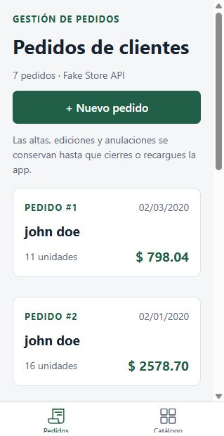
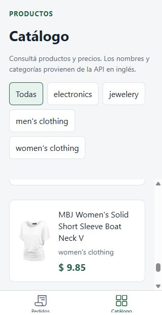
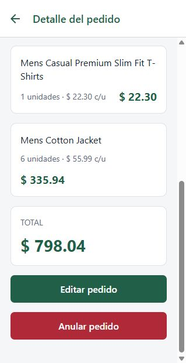
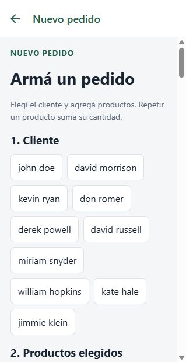
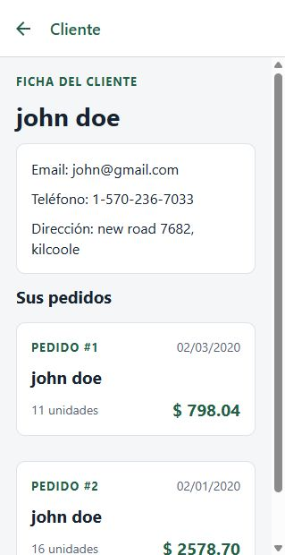

# Gestión de pedidos · TP Final Unidad 5

Ingeniería de Software II · IES Santa Fe N.º 9233 · Propuesta 3 · 2026.

Repositorio público: [eliascorti/tp-gestion-pedidos](https://github.com/eliascorti/tp-gestion-pedidos).

Aplicación de React Native con Expo para consultar pedidos y clientes, filtrar el catálogo y crear, editar y anular pedidos. Es una base pequeña para estudiar y mejorar: usa TypeScript, Expo Router, fetch y Context de React; no necesita un backend propio ni una cuenta de Expo para ejecutarse en Expo Go.

## Integrantes

- Elías Corti
- Joaquin Cavanna
- Tadeo Reinante
- Marco Turchi

## Versiones y ejecución

Se usó `npx create-expo-app@latest pedidos-app --template default@sdk-54`, respetando el SDK de la guía de instalación entregada por la cátedra.

| Herramienta  | Versión del proyecto                 |
| ------------ | ------------------------------------ |
| Node.js      | 24.19.0 (también fijada en `.nvmrc`) |
| Expo         | ~54.0.36                             |
| React        | 19.1.0                               |
| React Native | 0.81.5                               |
| Expo Router  | ~6.0.24                              |
| TypeScript   | ~5.9.2                               |

Desde PowerShell:

```powershell
nvm use 24.19.0
cd C:\Users\elias\Desktop\ing\pedidos-app
npm ci
npm start
```

Si todavía no tenés Node 24, primero ejecutá `nvm install 24.19.0`. En nvm para Windows, cambiar la versión puede requerir una terminal como administrador. En otro equipo, cambiá el `cd` por la carpeta donde clonaste el repositorio.

Instalá **Expo Go compatible con SDK 54**, conectá computadora y celular a la misma Wi-Fi y escaneá el QR. Expo Go y el SDK deben coincidir: no asumir que cualquier versión de la tienda sirve. Consultar [Expo Go](https://expo.dev/go) y [resolución de incompatibilidades](https://docs.expo.dev/troubleshooting/expo-go-version-mismatch/) si aparece un aviso. El SDK 54 está elegido por la guía de la cátedra; no actualizarlo automáticamente a otro SDK.

Para vista web, ejecutá `npm run web`. Para abrir Android, `npm run android` (con emulador o dispositivo disponible). Para resolver problemas de caché, `npx expo start --clear`. La app necesita internet para consultar la API y enviar operaciones; no tiene modo offline.

## Qué incluye

- Pedidos con cliente, fecha `dd/mm/aaaa`, unidades y total con dos decimales.
- Catálogo con imagen, precio y filtro de categorías, incluida “Todas”.
- Detalle con subtotales, enlace al cliente, edición y anulación con confirmación.
- Un único formulario para alta y edición: cliente, productos, cantidades con +/− o entrada manual, eliminación de ítems y total en vivo.
- Ficha del cliente con datos de contacto y pedidos navegables.
- Carga visible, errores con reintento, validación junto a los campos y confirmación de operaciones.
- Sin fetch por ítem: productos y clientes se cargan al iniciar y se construyen mapas por ID.

## API y consistencia de sesión

Base: `https://fakestoreapi.com`. Los pedidos se leen de `/carts`, los productos de `/products` y los clientes de `/users`. La guía de DummyJSON es una referencia de patrones; esta aplicación utiliza **Fake Store API**.

El 23/10/2026 se consultaron respuestas reales: 7 pedidos, 20 productos y 10 clientes. El pedido trae `id`, `userId`, `date`, `products` con `productId` y `quantity`, y `__v`. El producto también trae `rating`; la dirección del cliente incluye `zipcode` y `geolocation`. Los tipos conservan los campos utilizados; la app no usa las contraseñas ficticias que también devuelve `/users`.

Las escrituras de esta API son simuladas. El Context mantiene una lista inicial y un mapa de cambios locales: altas y ediciones guardan el pedido; las anulaciones guardan `null`. Por eso un cambio se refleja en todos los listados durante la sesión y se pierde al cerrar o recargar la aplicación. Los pedidos nuevos se resuelven desde ese estado y no se buscan en GET remoto.

La API puede repetir el mismo ID en POST sucesivos. Se reserva un identificador único dentro de la sesión para evitar sobrescribir altas anteriores. DELETE sobre un alta local puede devolver `null` con HTTP 200: se considera una anulación correcta. No se reemplazan respuestas fallidas por éxitos ficticios.

## Estructura

Las rutas están en `src/app/`: `(tabs)` contiene las secciones principales y el stack contiene detalle, formulario y cliente. `components/` reúne UI reutilizable; `context/` comparte los datos y las modificaciones de la sesión.

`services/` concentra todas las llamadas HTTP, `types/` define las entidades, `utils/` contiene cálculos y formato, y `constants/` centraliza estilos y colores. `docs/` incluye capturas y una guía de defensa.

```text
src/
  app/
    _layout.tsx
    (tabs)/_layout.tsx  index.tsx  catalogo.tsx
    pedido/[id].tsx  nuevo.tsx  editar/[id].tsx
    cliente/[id].tsx
  components/
  constants/
  context/
  hooks/
  services/
  types/
  utils/
docs/
```

La plantilla original quedó conservada localmente en `app-example/`, ignorada por Git y por TypeScript. No participa de la aplicación.

## Capturas de las cinco pantallas

Capturas reales de la versión web en una vista angosta. La prueba en Expo Go físico queda a cargo del grupo.

| Pedidos                                  | Catálogo                                   |
| ---------------------------------------- | ------------------------------------------ |
|  |  |

| Detalle                                  | Formulario compartido                          |
| ---------------------------------------- | ---------------------------------------------- |
|  |  |



## Uso de IA

**Herramienta:** Codex (OpenAI), para leer la consigna, generar la base y verificar el código. La documentación se consultó en Expo y se contrastaron los endpoints con respuestas reales de Fake Store API.

**Prompt recibido del estudiante:**

> Necesito hacer este proyecto de ingeniería de la facultad con React y Expo, según los SDK, versiones y demás. La idea es hacer ese TP y entregarlo, de la manera simple para que después los estudiantes podamos mejorar.

**Segundo prompt del estudiante:**

> No hagas ningún test ni nada, tiene que ser como alumnos de una tecnicatura, no dimos eso.

Se quitaron las pruebas automatizadas y el informe de validación para mantener el alcance pedido por el grupo.

**Tercer pedido del estudiante (resumen):**

> Publicar el proyecto como repositorio público, organizar los commits por partes y dividir el trabajo en algunas ramas, sin coautoría automática.

El repositorio se organizó en `main`, `feature/datos-api`, `feature/pantallas` y `docs/entrega`. Los commits se agruparon por configuración, datos, cálculos, componentes, pantallas y documentación. Se conservaron las fechas reales y la cuenta Git configurada, sin atribuir aportes a otros integrantes.

**Dos errores concretos de la primera implementación con IA y sus correcciones:**

1. El servicio inicialmente rechazaba toda respuesta `null`, incluido DELETE exitoso de un pedido creado en sesión. La API respondió HTTP 200 con `null`; se corrigió para permitir ese valor exclusivamente para DELETE. GET de un registro ausente sigue mostrando error.
2. El selector inicialmente copiaba `String(cantidad)` al texto del campo incluso cuando la cantidad inválida era `NaN`. Eso reemplazaba lo escrito por el usuario por “NaN”. Se corrigió para sincronizar solamente números finitos y conservar el texto inválido, mostrando la validación junto al campo.

El grupo debe leer y entender todos los archivos. Ver [guía de defensa](docs/DEFENSA.md) para el orden de lectura y ejercicios de cambios sin IA.

## Antes de entregar

- [ ] Completar la fecha de entrega.
- [ ] Completar la sección de prompts con usos reales del grupo.
- [ ] Probar CRUD y navegación completa en un celular con Expo Go para SDK 54.
- [ ] Probar inicio, categorías, detalle y formulario en modo avión; comprobar errores y reintento al recuperar conexión.
- [ ] Revisar las cinco capturas y guardar capturas del celular si la cátedra las solicita.
- [x] Publicar el repositorio incluyendo código, lockfile, documentación y capturas.
- [ ] Cada integrante debe aportar cambios propios y commits con su identidad. No simular participación ni autores.
- [ ] Ensayar la defensa y un cambio pequeño sin IA.
